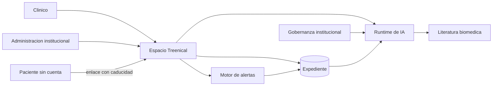

# Contexto del sistema

Treenical es un sistema operativo clínico: un espacio de trabajo para el clínico y, cuando hace falta, para la institución. El paciente entra solo al canal que el clínico le abre. No tiene cuenta en el producto.

## Actores

## Qué hace cada capa

| Capa | Responsabilidad |
|---|---|
| Espacio de trabajo | Pantallas, sesión del clínico y orquestación de cada feature |
| Expediente | Fuente de verdad clínica. Dueño, historia estructurada, eventos, encuentros |
| Motor de alertas | Reglas deterministas sobre observaciones. La misma serie produce la misma alerta |
| Runtime de IA | Única puerta hacia modelos y hacia la recuperación de literatura |
| Gobernanza | Protocolos versionados, resueltos para la persona que está usando el sistema |
| Canal del paciente | Conversación temporal, separada de la cuenta del clínico |

## Decisión: un monolito modular

Las features comparten un expediente y una sesión. Partirlas en servicios independientes obligaría a distribuir una transacción clínica —aceptar una propuesta, escribir el chart y dejar constancia— entre redes y equipos que no existen como frontera de despliegue.

El corte está en el código. Cada feature expone una API pública y esconde su acceso a datos. Otra feature consume esa API. Un cambio de expediente no se cuela en la pantalla de evidencia por un import profundo.

La base sigue siendo una. La autorización de las filas del clínico vive ahí, no en un servicio aparte que pueda divergir.

## Decisión: el modelo no es un actor con pluma

El runtime propone, resume, transcribe y reescribe. El expediente cambia cuando un clínico acepta. Esa regla atraviesa la extracción desde una nota, el copiloto, el asistente y el seguimiento. Está detallada en [Fronteras](12-fronteras.md).

## Fuera de este documento

La generación de algoritmos clínicos usa el mismo espacio de trabajo y el mismo runtime, y su diseño no se publica en este repositorio.
