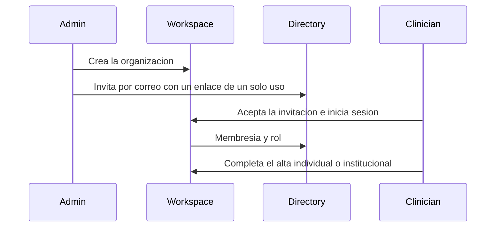

# Identidad, organizaciones y acceso

## Para qué existe

Separar tres cosas que un producto clínico suele mezclar: la persona que inicia sesión, la institución a la que pertenece y el expediente que esa persona puede abrir.

## Actores

- **Clínico.** Tiene cuenta, ve sus pacientes y trabaja en el espacio.
- **Administración de la organización.** Invita miembros y administra esa organización.
- **Administración de la plataforma.** Rol estrecho para operación, no para el trabajo de cabecera.
- **Paciente.** No tiene cuenta. Su acceso está descrito en [Mensajes y seguimiento](09-mensajes-y-seguimiento.md).

## Flujo

El alta pregunta si quien entra es un clínico o una organización, porque el resto del producto cambia de escala: una persona con sus pacientes, o una institución con protocolos y miembros.

## Datos que posee

- Perfil de la cuenta.
- Roles.
- Organizaciones, miembros e invitaciones.
- Institución primaria, que más adelante acota la gobernanza.

## Decisiones

**La membresía institucional no abre el expediente de otro clínico.** Pertenecer a la misma organización permite gobernanza, invitaciones y administración. El chart sigue teniendo un clínico dueño. Abrir el expediente por el solo hecho de compartir institución mezclaría un directorio de personas con la historia de un paciente.

**El rol se escribe en un solo lugar.** La administración asigna roles. El resto de las features pregunta el rol; no lo edita de paso.

**La invitación es un enlace con destinatario, no una cuenta compartida.** Quien acepta entra con su propia identidad. El correo de la invitación tiene que coincidir con quien inicia sesión.

**El paciente no se modela como un usuario a medias.** Un portal con registro, recuperación de contraseña y dispositivo recordado es otro producto. Treenical mantiene al paciente fuera del directorio de cuentas y le abre un canal temporal. Así la autorización del chart no tiene un segundo tipo de sesión que las políticas de fila no conocen.
