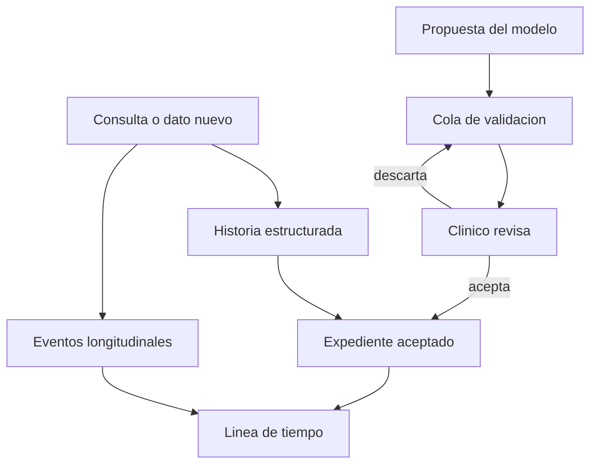

# Expediente longitudinal

## Para qué existe

Guardar una comprensión del paciente que sobreviva a la consulta: problemas, medicación, alergias, antecedentes y los hechos que ocurrieron después, en orden.

## Flujo

## Datos que posee

- El paciente y su clínico dueño.
- Secciones estructuradas de la historia: diagnósticos, condiciones crónicas, alergias, medicación, antecedentes quirúrgicos, familiares y sociales.
- Eventos longitudinales: laboratorios, visitas, procedimientos, ingresos, imagen.
- Encuentros.
- La cola de validación: propuestas todavía no aceptadas.
- Etiquetas del propio clínico para organizar su lista.

## Decisiones

**Historia estable y línea de tiempo son registros distintos.** La medicación de base no es lo mismo que el laboratorio del martes. Mezclarlos en una sola lista obliga a cada pantalla a adivinar qué filas son “el paciente” y cuáles son “lo que pasó”. El copiloto, las alertas y la línea de tiempo leen el corte que les corresponde.

**Lo que escribe una persona y lo que propone un modelo no comparten estado.** Una fila aceptada tiene marca de validación humana. Una propuesta espera en la cola. El expediente que leen las alertas y el contexto del asistente es el aceptado.

**Aceptar deja atribución.** Cuando un clínico empuja una propuesta al perfil, el sistema registra quién aceptó, sobre qué paciente y desde qué conversación. La frase entra al chart y el rastro entra a gobernanza. Véase [Gobernanza](07-gobernanza.md).

**Un encuentro activo por paciente.** La consulta en curso es una, para que la nota, la transcripción y el seguimiento apunten al mismo episodio. Los encuentros cerrados permanecen como historia.

**La línea de tiempo es una lectura, no un segundo expediente.** No se edita “el evento de la línea” por un lado y el laboratorio por otro. La línea proyecta los hechos ya guardados.

## Qué no hace esta feature

No calcula alertas. No busca literatura. No conversa con el paciente. Esas features leen el expediente por su API y escriben de vuelta solo cuando el contrato lo permite: una propuesta, o un hecho que el clínico cargó.
