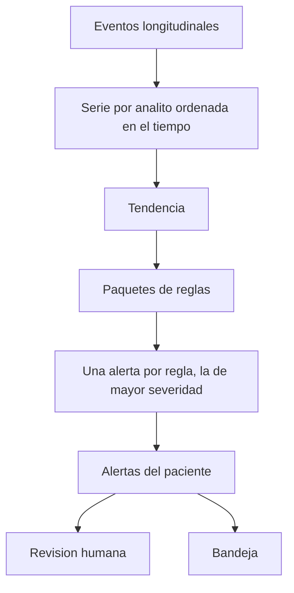

# Alertas clínicas

## Para qué existe

Señalar un cambio en los datos estructurados del paciente con una regla que se puede repetir. Si los mismos laboratorios entran dos veces, la alerta es la misma.

## Flujo

## Datos que posee

- La alerta calculada: regla, severidad, observación que la disparó, paciente.
- El estado de revisión del clínico.

Las observaciones no le pertenecen. Las lee del expediente.

## Decisiones

**El motor no llama a un modelo.** Una alerta que depende de un texto generado cambia cuando cambia el modelo, el prompt o la temperatura. Una alerta de tendencia tiene que poder explicarse con la serie y la regla. El modelo puede narrar después. No decide si la alerta existe.

**Las reglas entran como paquetes, no como ramas dentro del motor.** El núcleo arma el contexto —paciente, series, última observación, tendencia— y ejecuta cada paquete registrado. Un paquete nuevo (una guía renal, un protocolo del hospital) se agrega al registro. El núcleo no se reescribe para conocer esa guía.

**Si dos paquetes disparan la misma regla, queda la severidad más alta.** El clínico ve un hecho, no dos tarjetas por el mismo analito.

**Revisar una alerta no borra la serie.** La revisión marca el juicio del clínico. La próxima corrida vuelve a leer los datos. Así la bandeja puede archivar lo ya visto sin convertir el motor en un diario editable.

**La explicación cita la regla, no una razonamiento libre.** El clínico puede pedir por qué apareció la alerta y recibe el trazado determinista: qué observación, qué tendencia, qué regla. Esa explicación es auditable al margen del asistente.

## Cómo la usa el resto del sistema

La bandeja ordena las alertas por severidad, por encima del trabajo administrativo. El modo Audit del asistente, cuando hay un paciente enlazado, recibe este contexto ya calculado. El asistente no recalcula la tendencia por su cuenta.
