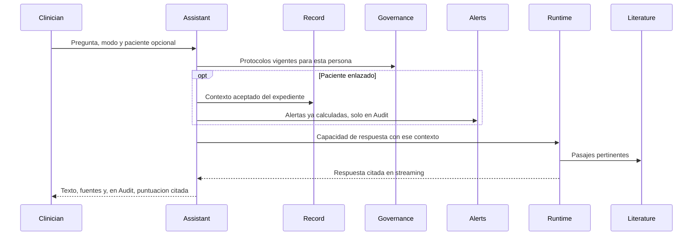

# Asistente clínico

## Para qué existe

Responder una pregunta de cabecera con el expediente enlazado, la literatura recuperada y la gobernanza de quien pregunta. La respuesta se cita. La evidencia y la política institucional se nombran por separado.

Este documento cubre esa conversación. No cubre la generación de algoritmos, árboles de decisión ni mapas mentales.

## Tres profundidades

| Modo | Qué hace | Cuándo se usa |
|---|---|---|
| Rapid | Búsqueda enfocada en fuentes de confianza y respuesta breve de cabecera | La pregunta cabe en la consulta |
| Dive | Recuperación más amplia, en paralelo, y después un ranking clínico | Hace falta ver el cuerpo de la literatura |
| Audit | La misma profundidad de búsqueda que Rapid, más una revisión citada de la conducta | Hay que mirar una decisión ya tomada, con un paciente enlazado |

## Datos que posee

- Conversaciones del clínico, mensajes y el modo de cada turno.
- Grupos y etiquetas para ordenar esas conversaciones.
- El enlace opcional entre una conversación y un paciente.
- El consentimiento registrado cuando el contenido de esa conversación puede salir hacia el expediente.

No posee la literatura ni el protocolo. Los pide en el momento de la pregunta.

## Decisiones

**Tres modos, una sola tubería.** Rapid, Dive y Audit cambian cuánta literatura se recupera y si entra la revisión de conducta. No son tres productos con tres clientes de modelo. Comparten el runtime, las citas y el expediente.

**El paciente es un enlace explícito, no un adivinado.** El asistente usa el chart cuando el clínico lo vincula. Una pregunta general no arrastra el último expediente abierto. Vincular deja un evento de auditoría.

**Audit no inventa una segunda búsqueda para “pensar más”.** Revisa la conducta con la evidencia de Rapid y, si hay paciente, con las alertas deterministas. Profundizar la literatura es Dive. Mezclar las dos perillas hacía imposible saber si una respuesta larga venía de más papeles o de más opinión.

**La puntuación de Audit es citada y acotada.** Dimensiones clínicas, cada una con fuentes. No es un semáforo único sobre “si el clínico lo hizo bien”. El juicio sigue siendo de la persona.

**Empujar una frase al expediente pasa por la cola de validación.** El asistente puede proponer que un hallazgo entre al perfil. Entra cuando el clínico acepta, con atribución. El mensaje de chat no es una fila clínica.

**La respuesta llega en streaming.** El clínico lee mientras el runtime sigue. Las fuentes y la puntuación de Audit se muestran cuando su bloque está completo, para no pintar una cita a medias.

## Qué queda fuera

La generación de algoritmos a partir de un texto, una imagen o un documento, y la biblioteca de gráficos que esa generación alimenta, no forman parte de este showcase.
