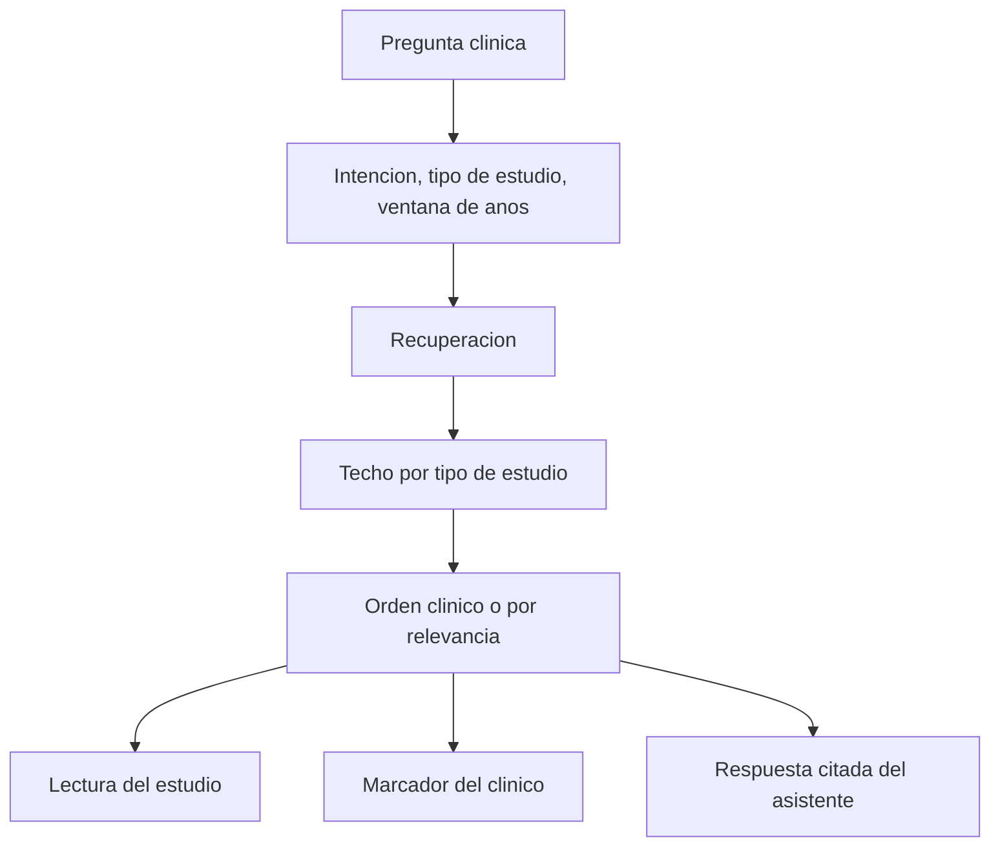

# Evidencia

## Para qué existe

Traer a la consulta la literatura que responde la pregunta, con tipo de estudio, año y un enlace, sin salir del expediente ni del asistente.

## Flujo

## Datos que posee

- Marcadores del clínico: título, fuente, año, enlace.
- Recortes reutilizables que el clínico guarda para citar después.

El corpus bibliográfico no es un expediente de pacientes. La búsqueda lo consulta; no lo mezcla con el chart.

## Decisiones

**Evidencia y gobernanza responden preguntas distintas.** Evidencia dice qué sostiene la literatura. Gobernanza dice qué exige esta institución. El asistente tiene que poder marcar una frase como una cosa o la otra. Si el protocolo local y un ensayo dicen cosas distintas, la respuesta lo muestra. No funde los dos textos en un consejo único.

**La pertinencia gana al prestigio.** Una revista conocida no asciende un pasaje que no contesta la pregunta. El orden por defecto es clínico: qué tipo de estudio, qué tan directamente responde, qué tan reciente es la ventana pedida. Existe un orden por relevancia textual para cuando el clínico quiere ver el emparejamiento crudo.

**El tipo de estudio pone un techo, no una medalla.** Una guía o una revisión sistemática pueden llegar más alto que un artículo narrativo. Un resumen demasiado fino para clasificar se marca como no graduado. El sistema no inventa un grado A para no dejar el hueco vacío.

**La intención de la pregunta cambia el corte.** Terapia, diagnóstico, pronóstico, daño y mecanismo no se buscan con el mismo filtro. El clínico puede fijar además el tipo de estudio y una ventana de cinco o diez años.

**El pasaje que responde se lee antes que el fondo.** Antecedentes y texto de portada no sustituyen el resultado que contesta la pregunta. El cromo de un sitio —menús, pie, página de inicio— no cuenta como evidencia clínica.

**Un hecho de medicamento sale de la ficha técnica.** Una nota de prensa no se trata como etiqueta del fármaco. Un preprint no se trata como guía publicada.

**Guardar es del clínico, buscar es compartible.** El marcador pertenece a quien lo guardó. La búsqueda no escribe en el expediente. Si una conclusión debe entrar al chart, el camino es la cola de validación, igual que en el asistente.

## Lectura

Abrir un resultado muestra las secciones que el resumen sí trae —población, intervención, desenlace, conclusión— y omite las que no están. Completarlas con prosa generada haría pasar un hueco por un dato.
