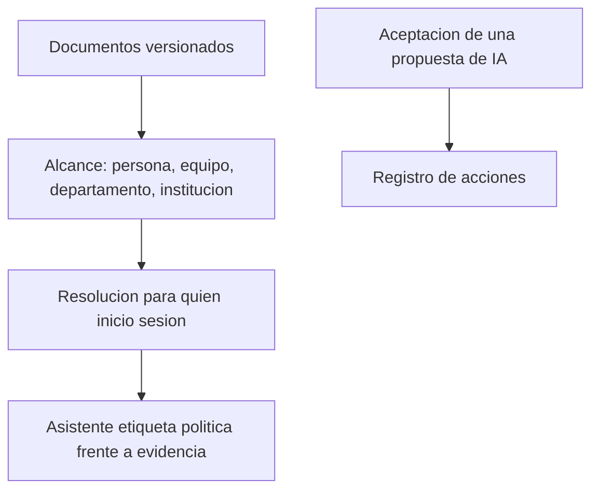

# Gobernanza

## Para qué existe

Hacer que la misma pregunta clínica pueda respetar el protocolo, el formulario, la norma local y el estilo de recomendación de una institución, sin reescribir el asistente para cada hospital.

## Flujo

## Datos que posee

- Documentos de gobernanza y sus versiones.
- El alcance de cada documento.
- Atribuciones: qué contenido generado fue aceptado, por quién y sobre qué paciente.
- Registro de auditoría de acciones sensibles: vincular un paciente a una conversación, empujar una propuesta al perfil, y las acciones equivalentes de otras features.

## Decisiones

**La resolución ocurre en el servidor, con la identidad de quien pregunta.** El cliente recibe los documentos que ya aplican y los prepara como contexto. No recorre el árbol de institución, departamento y equipo en el navegador, donde sería fácil que dos pantallas divergieran.

**El alcance fino no es lo mismo que la frontera de la institución.** Quien pertenece a la institución puede leer los documentos de esa institución. Escribirlos exige un rol de gestión. Qué documento aplica a esta persona —el suyo, el de su equipo, el del departamento, el de la institución— lo resuelve la consulta de gobernanza, de más específico a más general.

**Hay un orden cuando las reglas chocan.** Seguridad del paciente, integridad de la evidencia, norma, política institucional, preferencia de la persona, estilo. La política institucional no pisa la seguridad ni la evidencia. El asistente tiene que distinguir las tres voces: lo que dice la literatura, lo que dice el protocolo, lo que es preferencia administrativa.

**Versionar el documento, no editarlo en silencio.** Una recomendación citada contra “el protocolo de anticoagulación” tiene que poder señalar una versión. La versión anterior permanece.

**La auditoría registra el acto, no el contenido clínico completo.** Vincular, aceptar, promover. El expediente sigue siendo el lugar del dato. El registro es el lugar del quién y el cuándo.

## Relación con la evidencia

Gobernanza no busca papers y evidencia no guarda protocolos. Las dos alimentan al asistente por el runtime, cada una con su contrato. Esa separación está en [Fronteras](12-fronteras.md).
