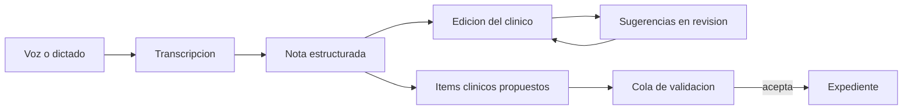

# Documentación clínica

## Para qué existe

Pasar de lo dicho en la consulta a una nota estructurada, y de esa nota a propuestas sobre el expediente, sin saltarse al clínico.

## Flujo

## Datos que posee

- Transcripciones del clínico.
- Plantillas de nota del clínico.
- El texto de la nota en edición.

Los ítems aceptados dejan de ser documentación y pasan al expediente.

## Decisiones

**La transcripción y la nota son artefactos distintos.** La transcripción conserva el diálogo. La nota es el documento clínico. Generar la nota no borra lo dicho: el clínico puede volver a la fuente si la nota se desvió.

**Reescribir es una sugerencia, no un reemplazo silencioso.** Mejorar el texto propone un cambio que se revisa como una corrección marcada. El clínico acepta o rechaza. Un modelo que pisa el párrafo mientras se escribe deja sin autor a la nota.

**Extraer ítems no escribe el chart.** Diagnósticos, medicación u otros hechos detectados en la nota salen como propuestas hacia la cola de validación. La documentación clínica no tiene permiso de insertar en la historia por su cuenta. Pide la API del expediente.

**Las plantillas son del clínico.** Un servicio, un tipo de entrevista o un seguimiento pueden tener otra estructura. La plantilla organiza la nota. No es gobernanza institucional: el protocolo vive en gobernanza y se aplica cuando el asistente razona, no cuando el editor maqueta secciones.

**La voz de cabecera y la entrevista larga no comparten el mismo camino de captura.** Un dictado corto y una entrevista de consulta tienen duraciones, hablantes y destinos distintos. Unificarlos en un solo botón obligaba a perder o al hablante o a la inmediatez. Los dos terminan en texto que el clínico edita.

## Qué conserva del encuentro

La nota puede nacer de una entrevista marcada como seguimiento. Programar el check-in con el paciente es otra feature: el objeto vive en el canal de mensajes, no dentro del editor. Véase [Mensajes y seguimiento](09-mensajes-y-seguimiento.md).
