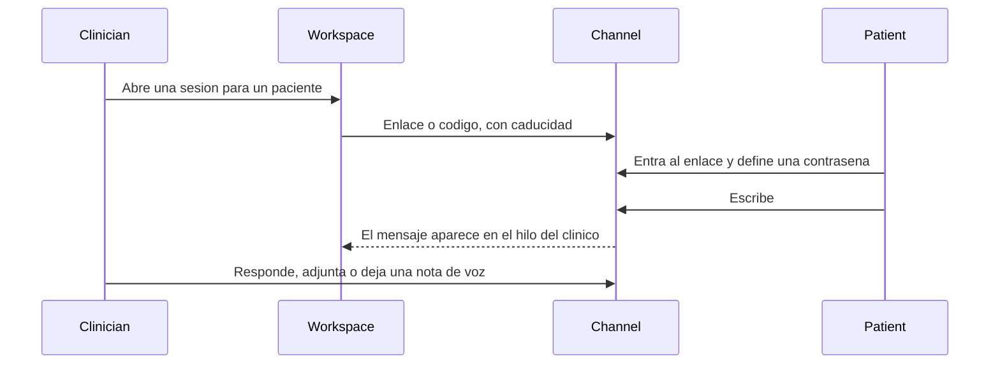
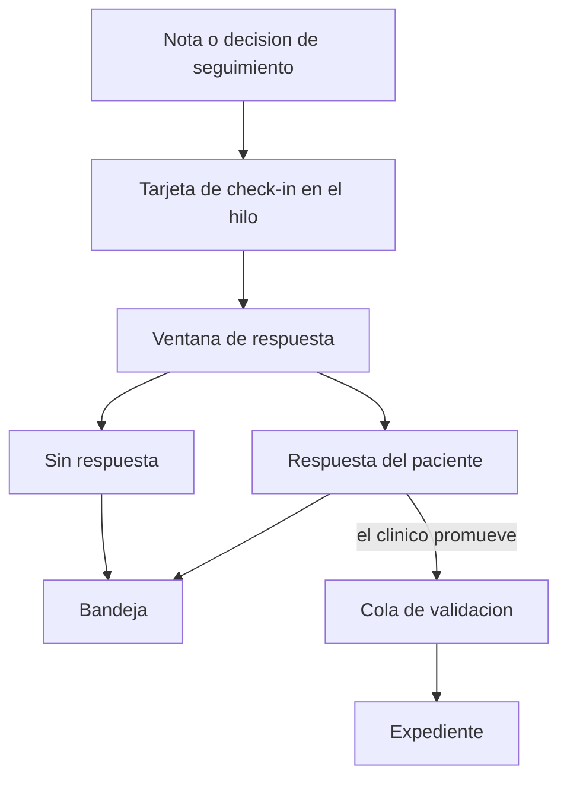

# Mensajes y seguimiento

## Para qué existe

Sostener el intervalo entre visitas. El paciente escribe sin crear una cuenta. El clínico ve ese hilo en el mismo lugar donde ve alertas y revisiones pendientes. Un check-in programado es un objeto clínico dentro de ese hilo, no una campaña de recordatorios.

## Flujo del canal

El escritorio del clínico recibe el hilo en tiempo real. El paciente consulta el canal con su sesión temporal. No se le abre una suscripción al expediente.

## Flujo del seguimiento

## Datos que posee

- La sesión: clínico dueño, paciente, caducidad, secreto del enlace.
- Los mensajes de esa sesión.
- La tarjeta de seguimiento: día previsto, prioridad, estado de respuesta.
- El consentimiento para que el clínico exporte o importe contexto de IA en ese hilo.

La contraseña del paciente se guarda solo como hash. El enlace no es una sesión de producto.

## Decisiones

**Sin cuenta, con cierre.** El paciente no descarga una aplicación ni recupera una contraseña de Treenical. Entra por un enlace, pone una contraseña para ese hilo y la sesión dura lo que dura el enlace. Al cerrar, los mensajes se borran. Lo que el clínico haya promovido al expediente permanece ahí, porque ya no es un mensaje: es un dato aceptado.

**Un hilo activo por paciente.** El intervalo entre visitas es una conversación con el clínico dueño, no una bandeja de equipo ni un portal familiar. Prioridad, archivo y etiquetas alcanzan para ordenar. Un inbox compartido de recepción es otro oficio.

**El aviso hacia afuera no lleva contenido clínico.** Si se señala que hay un mensaje, el aviso no incluye el texto ni el diagnóstico. El contenido se lee dentro del enlace.

**El seguimiento es una tarjeta, no más prosa.** A los pocos días de la visita el clínico puede dejar un check-in concreto en el hilo que ya existe. La falta de respuesta y la respuesta que pide atención suben a la bandeja. El “hace sesenta días que no actualizo este paciente” sigue existiendo como señal de roster; no se confunde con un check-in que alguien se comprometió a mirar.

**Promover al chart usa la misma cola que el resto de la IA.** Un resumen del hilo no se vuelca solo al expediente. El clínico lo acepta. Así un mensaje de paciente no se convierte en un diagnóstico por el camino corto.

**La asistencia dentro del hilo la pide el clínico.** El modelo puede ayudar a redactar sobre ese canal cuando el dueño de la sesión lo invoca, con el contexto que el consentimiento permite. El mensaje del paciente no dispara una escritura automática.

## Qué no es

No es un conmutador, ni una campaña de inasistencia, ni un portal de resultados. Esas operaciones pertenecen a la recepción. Este canal pertenece al razonamiento entre una visita y la siguiente.
