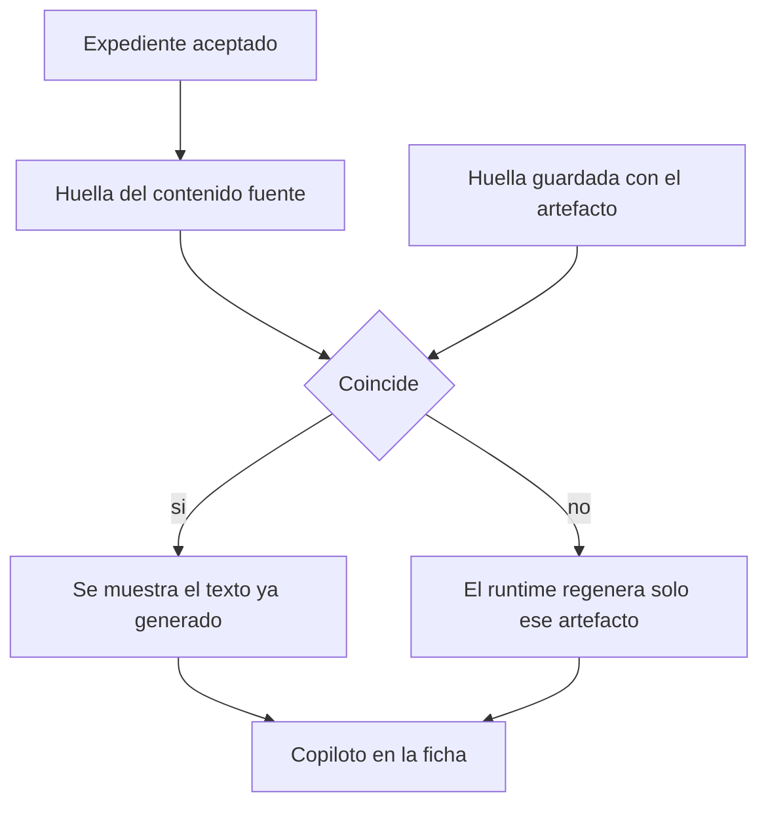

# Copiloto del paciente

## Para qué existe

Ofrecer, al abrir el expediente, una lectura corta de quién es el paciente y de qué cambió hace poco. La lectura es narrativa. La fuente de verdad sigue siendo el expediente estructurado.

## Dos artefactos

| Artefacto | Qué resume | De dónde sale |
|---|---|---|
| Retrato | La línea de base estable: problemas, medicación, alergias, antecedentes | Secciones aceptadas de la historia, más hitos mayores |
| Reciente | Lo ocurrido en la ventana reciente y el último encuentro cerrado | Filas nuevas, eventos y el encuentro |

## Datos que posee

- El texto de cada artefacto.
- La huella de los datos que lo produjeron.
- La versión de la forma del artefacto, para regenerar si el formato cambia aunque los datos no.

## Decisiones

**Se regenera cuando cambia la fuente, no cuando se abre la ficha.** Abrir un paciente no es motivo para volver a llamar al modelo. Una huella del contenido fuente viaja con el artefacto. Si la huella coincide, el texto guardado se muestra. Si no, se pide de nuevo solo el artefacto que cambió. El servidor vuelve a comprobar la huella y descarta una carrera en la que el dato ya no se movió.

**Retrato y reciente no comparten huella.** Un laboratorio de esta semana no debe reescribir el retrato de las alergias. Un cambio de medicación de base no debe esperar a que también haya un evento reciente. Cada artefacto mira su propio corte del expediente.

**El copiloto no es un segundo chart.** No se edita la narrativa para corregir un diagnóstico. Se corrige la fila estructurada. La próxima huella distinta regenera el texto. Editar el resumen a mano crearía dos verdades.

**Solo entra lo ya aceptado.** Las propuestas de la cola de validación no alimentan el retrato. Un ítem que el modelo extrajo y nadie confirmó no aparece como antecedente.

**Es una lectura de cabecera, no una respuesta citada.** Para una pregunta con literatura está el asistente. El copiloto no busca papers y no aplica gobernanza. Su trabajo es que la ficha se pueda leer en unos segundos antes de hacer cualquiera de esas dos cosas.
