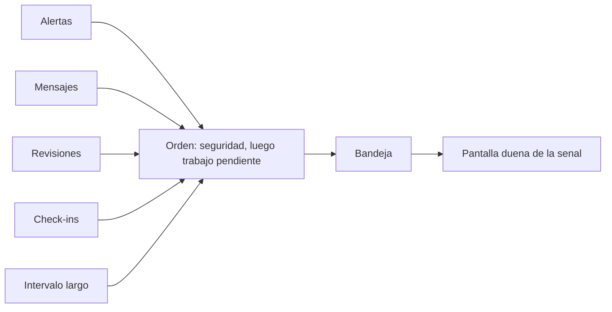

# Bandeja de trabajo

## Para qué existe

Responder “qué hago ahora” con una sola lista. Las features producen señales. La bandeja no las reinterpreta: las ordena y abre la pantalla dueña de cada una.

## Qué entra

| Señal | Origen | A dónde lleva |
|---|---|---|
| Alerta clínica | Motor de alertas | Ficha del paciente, en su línea longitudinal |
| Mensaje del paciente sin leer | Canal de mensajes | El hilo de esa sesión |
| Propuestas esperando revisión | Cola de validación | La revisión de ese paciente |
| Check-in respondido o en silencio | Seguimiento | El hilo donde vive la tarjeta |
| Paciente sin actualización reciente | Roster | La ficha, como señal de intervalo largo |

## Datos que posee

Ninguno clínico. La bandeja es una proyección. No guarda una copia del laboratorio ni del mensaje.

## Decisiones

**Una lista, cinco procedencias.** El clínico no recorre alertas en un módulo, mensajes en otro y revisiones en un tercero para saber por dónde empezar. Cada ítem conserva su tipo, así que el orden compartido no borra la diferencia entre un potasio y un check-in.

**La seguridad ordena por encima del trabajo administrativo.** Una alerta severa queda antes que un mensaje o que un paciente al que hace tiempo no se actualiza. El intervalo largo importa, y no compite con un resultado que pide mirada hoy.

**Abrir no es resolver.** Entrar al hilo no marca el mensaje como leído por el solo hecho de ver la lista, y archivar una alerta no reescribe la serie. Cada feature dueña define qué significa “ya está visto”. La bandeja solo enruta.

**El intervalo largo no es un seguimiento.** Un paciente sin cambios en el roster desde hace mucho aparece como posible pérdida de contacto. Un check-in es un compromiso con fecha dentro del hilo. Los dos pueden coincidir en la bandeja y se rotulan distinto, porque la acción no es la misma.

**La bandeja no llama al modelo.** Ordenar trabajo pendiente con un modelo haría la lista inestable entre dos refrescos. Las reglas de orden son fijas. El texto de cada ítem sale de la feature que lo originó.
