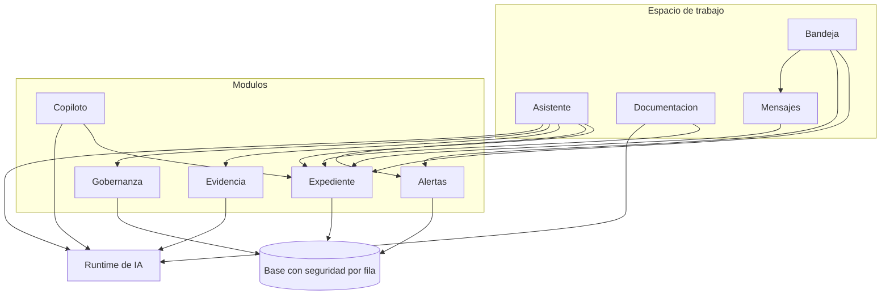
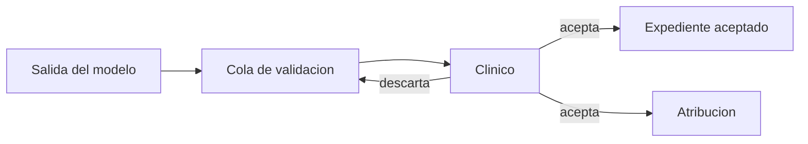

# Fronteras que atraviesan todas las features

Estas decisiones no pertenecen a una pantalla. Si una feature las rompe, el resto del diseño deja de sostenerse.

## 1. Módulos con API pública

Cada feature es un módulo: expediente, alertas, asistente, evidencia, gobernanza, documentación, mensajes, copiloto, identidad. Hacia afuera exporta operaciones. Hacia adentro esconde consultas y componentes.

Una pantalla de documentación que necesita guardar un diagnóstico llama la operación del expediente. No abre la tabla de la historia por su cuenta. Esa es la razón por la que extraer ítems y promover un mensaje terminan en la misma cola: hay un solo camino de escritura.

## 2. La fila autoriza al clínico

Para los datos del clínico, la base decide si esa persona puede leer o escribir la fila. Los dos patrones son simples a propósito.

- Dueño directo: la conversación, la nota, el marcador, la plantilla.
- Dueño a través del paciente: la historia, el evento, la alerta, la propuesta. Si la persona es dueña del paciente, alcanza esas filas.

La interfaz puede esconder un botón. No es la frontera. Si mañana otra pantalla olvida el botón, la fila sigue cerrada.

El canal del paciente es el caso aparte, porque el paciente no tiene cuenta. Su autorización vive en el enlace, la contraseña hasheada y la caducidad de esa sesión, comprobadas en el servidor. El clínico dueño sigue siendo el dueño de la sesión. El paciente no recibe una credencial que sirva para el expediente.

## 3. Un runtime, muchas features

El asistente, la nota, la extracción, la transcripción, el resumen de evidencia y el copiloto necesitan un modelo o una búsqueda. Todos pasan por el mismo runtime.

El contrato, visto desde una feature, es pequeño:

1. Nombra la capacidad.
2. Entrega el contexto que esa capacidad puede ver.
3. Recibe un resultado estructurado, a veces en streaming.
4. Trata los límites de uso como un fallo de la capacidad, no como un error inventado en cada pantalla.

El runtime concentra la llamada al modelo, la recuperación de literatura, el registro mínimo de cada llamada y el lugar donde más adelante se puede validar la forma de la salida. Las features no eligen proveedor ni pegan un prompt propio.

Los prompts, el enrutamiento concreto y la telemetría interna no se publican.

## 4. Evidencia, gobernanza y alertas no se sustituyen

| Capa | Pregunta | Cómo se equivoca si se mezcla |
|---|---|---|
| Alertas | ¿Qué muestra esta serie, con esta regla? | Un modelo “suaviza” un potasio |
| Evidencia | ¿Qué dice la literatura pertinente? | Un protocolo local se cita como ensayo |
| Gobernanza | ¿Qué exige esta institución, en esta versión? | Una guía internacional pisa el formulario real |

El asistente puede mostrar las tres en una respuesta. No las fusiona en una sola voz.

## 5. Nada generado entra al chart sin una persona

Aplica a la extracción desde una nota, a lo que el asistente propone empujar, al resumen de un hilo con el paciente y a cualquier narrativa que alguien quiera convertir en fila. El copiloto ni siquiera intenta ese salto: se regenera desde filas que ya están aceptadas.

## 6. La bandeja no posee datos

Proyecta señales y enruta. Si una regla de “ya lo vi” hiciera falta, vive en la feature dueña. Así la bandeja puede cambiar de orden sin redefinir qué es una alerta o qué es un mensaje.
