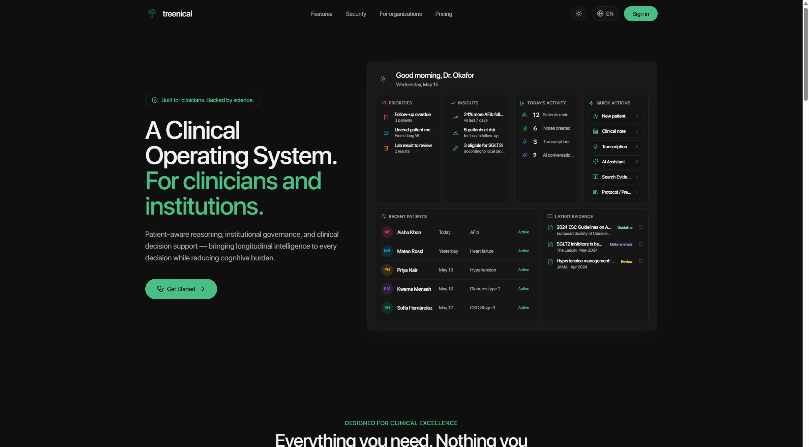
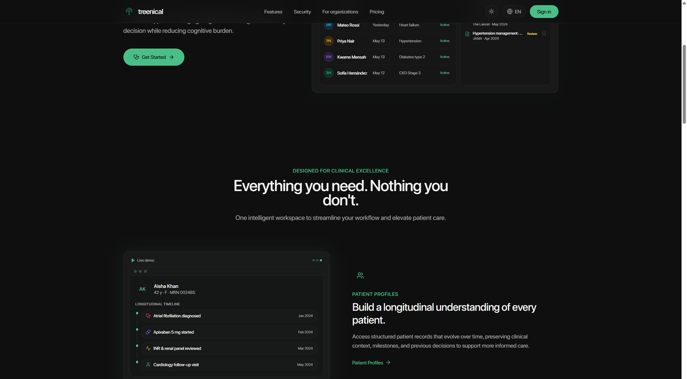
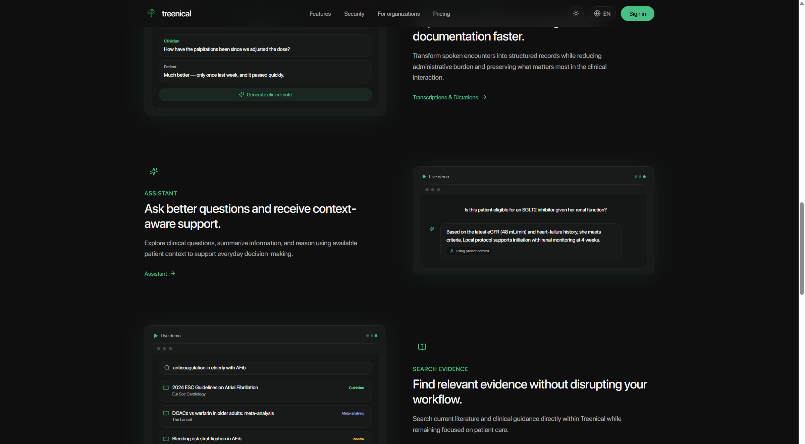
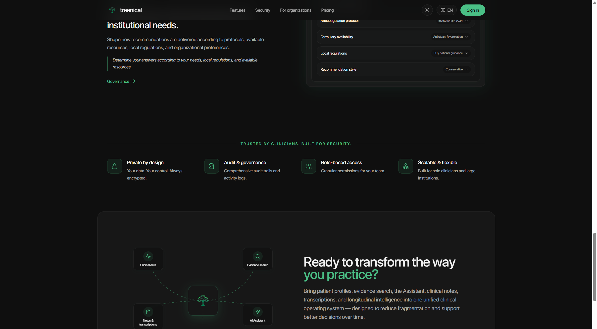

# Demo

Capturas de la superficie pública del producto: [treenical.lovable.app](https://treenical.lovable.app). Las personas que aparecen (Aisha Khan, Mateo Rossi, y el resto) son ilustraciones de esa página, no expedientes reales.

El recorrido autenticado —ficha, nota, asistente, evidencia, gobernanza y mensajes— no se publica aquí. Tampoco hay un video en este repositorio: cuando exista un recorrido grabado sin datos reales, puede agregarse como `demo/recorrido.mp4`.

## Capturas

### Portada

El espacio de trabajo que el producto promete: prioridades, pacientes recientes y evidencia, en una sola vista.

### Expediente longitudinal

La línea de tiempo como lectura del paciente, separada de la nota y de la búsqueda.

### Asistente y evidencia

La pregunta de cabecera usa el contexto del paciente. La búsqueda muestra tipo de estudio y fuente, al lado de la consulta.

### Gobernanza y confianza

El protocolo institucional se configura aparte de la literatura. El acceso es por roles, con auditoría y cifrado.

## Qué muestran y qué no

Muestran el problema que el producto declara y las features que este showcase documenta. No muestran pantallas con sesión iniciada, prompts, ni la generación de algoritmos.
